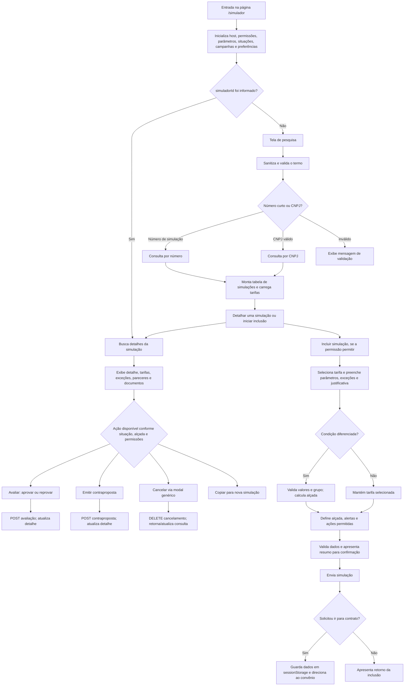

Vou mapear o componente, seus imports/serviços/templates/estilos e as dependências chamadas por esses fluxos; depois sintetizo o comportamento em um esquema.

Find files matching `src/app/pages/simulador/**/*`

Search for `^(import|\s*templateUrl|\s*styleUrls|\s*selector)|from ['"]`

Search for `\*ngIf|\*ngFor|\[routerLink\]|\(click\)|\(submit\)|\(change\)|\(keyup\)|\(blu...`

Read , lines 1 to 250
Completed with input: {
  "path": "C:\\desenvolvimento\\ssh\\SIACC-pixautomatico-frontend\\src\\app\\pages\\simulador\\simulador.component.ts",
  "view_range": [
    1,
    250
  ]
}

Ran terminal command: $files = @('src\app\pages\simulador\simulador.component.ts','src\app\pages\simulador\simulador.component.html','src\app\pages\simulador\simulador.component.scss','src\app\pages\simulador\simulador.component.spec.ts'); foreach ($file in $files) { '{0}: {1} lines' -f $file, (Get-Content $file).Count }

Search for `SimuladorComponent|pages/simulador|simulador.component|SimuladorService`

Search for `templateUrl|styleUrls|selector:`

Read , lines 251 to 550
Completed with input: {
  "path": "C:\\desenvolvimento\\ssh\\SIACC-pixautomatico-frontend\\src\\app\\pages\\simulador\\simulador.component.ts",
  "view_range": [
    251,
    550
  ]
}

Read , lines 1 to 350
Completed with input: {
  "path": "C:\\desenvolvimento\\ssh\\SIACC-pixautomatico-frontend\\src\\app\\pages\\simulador\\simulador.component.html",
  "view_range": [
    1,
    350
  ]
}

Search for `^\s*(async\s+)?(private\s+|public\s+|protected\s+)?[A-Za-z_$][\w$]*\([^;]*\)\...`

Search for `this\.(simuladorService|clienteService|modalService|router|sanitizer|snackBar...`

Search for `<(app-[\w-]+|dsc-[\w-]+|mat-[\w-]+|[a-z]+-modal)\b`

Search for `<!--|<h[1-6]|<legend|<mat-tab|<ng-template|<section|<form|<table`

Read 
Completed with input: {
  "path": "C:\\desenvolvimento\\ssh\\SIACC-pixautomatico-frontend\\src\\app\\services\\simulador\\simulador.service.ts"
}

Read 
Completed with input: {
  "path": "C:\\desenvolvimento\\ssh\\SIACC-pixautomatico-frontend\\src\\app\\shared\\shared.module.ts"
}

Read , lines 1 to 100
Completed with input: {
  "path": "C:\\desenvolvimento\\ssh\\SIACC-pixautomatico-frontend\\src\\app\\app-routing.module.ts",
  "view_range": [
    1,
    100
  ]
}

Ran terminal command: $p='src\app\pages\simulador\simulador.component.ts'; $lines=Get-Content $p; for($i=0;$i -lt $lines.Count;$i++){ if($lines[$i] -match '^\s*(async\s+)?(private\s+|public\s+|protected\s+)?[A-Za-z_$][\w$]*\([^;]*\)\s*(:\s*[^=]+)?\s*\{'){ '{0}: {1}' -f ($i+1),$lines[$i].Trim() } }

Ran terminal command: $p='src\app\pages\simulador\simulador.component.html'; $text=Get-Content -Raw $p; [regex]::Matches($text,'<([a-z][a-z0-9-]*)(?=[\s>/])') | ForEach-Object {$_.Groups[1].Value} | Sort-Object -Unique

Search for `^\s*(@import|@use)|url\(`

Read 
Completed with input: {
  "path": "C:\\desenvolvimento\\ssh\\SIACC-pixautomatico-frontend\\src\\app\\shared\\card-icones-restricao\\card-icones-restricao.component.ts"
}

Read 
Completed with input: {
  "path": "C:\\desenvolvimento\\ssh\\SIACC-pixautomatico-frontend\\src\\app\\services\\cliente\\cliente.service.ts"
}

Read 
Completed with input: {
  "path": "C:\\desenvolvimento\\ssh\\SIACC-pixautomatico-frontend\\src\\app\\services\\validators\\cnpj\\cnpj-validator.service.ts"
}

Read 
Completed with input: {
  "path": "C:\\desenvolvimento\\ssh\\SIACC-pixautomatico-frontend\\src\\app\\shared\\modal\\resumo-simulacao\\resumo-simulacao.component.ts"
}

Já confirmei os pontos de entrada, os elementos visuais e os serviços centrais. Agora estou organizando os métodos por fluxo (consulta, inclusão/alteração, avaliação, cancelamento e cálculo de alçada) e verificando as dependências transitivas relevantes para separar o que é arquivo direto do que é infraestrutura compartilhada.

Ran terminal command: $p='src\app\pages\simulador\simulador.component.ts'; $lines=Get-Content $p; for($i=0;$i -lt $lines.Count;$i++){ if($lines[$i] -match '^\s*(async\s+)?(private\s+|public\s+|protected\s+)?[A-Za-z_$][\w$]*\([^;]*\)\s*(:\s*[^=]+)?\s*\{'){ if(($i+1)-ge 450 -and ($i+1)-le 1600){ '{0}: {1}' -f ($i+1),$lines[$i].Trim() } } }

Ran terminal command: $p='src\app\pages\simulador\simulador.component.ts'; $lines=Get-Content $p; for($i=0;$i -lt $lines.Count;$i++){ if($lines[$i] -match '^\s*(async\s+)?(private\s+|public\s+|protected\s+)?[A-Za-z_$][\w$]*\([^;]*\)\s*(:\s*[^=]+)?\s*\{'){ if(($i+1)-ge 1601){ '{0}: {1}' -f ($i+1),$lines[$i].Trim() } } }

Ran terminal command: $p='src\app\pages\simulador\simulador.component.html'; $lines=Get-Content $p; for($i=0;$i -lt $lines.Count;$i++){ if($lines[$i] -match '<ng-template\s+#|<h[1-6]|<label[^>]*>|<(app-[\w-]+|parcel)\b'){ '{0}: {1}' -f ($i+1),$lines[$i].Trim() } }

Search for `import .* from|declarations:|SimuladorComponent|CardIconesRestricaoComponent|...`

Search for `^export (enum|interface|type|class)|^export const`

Search for `^(export )?(const|enum|interface|type)|^export`

Read , lines 400 to 570
Completed with input: {
  "path": "C:\\desenvolvimento\\ssh\\SIACC-pixautomatico-frontend\\src\\app\\pages\\simulador\\simulador.component.ts",
  "view_range": [
    400,
    570
  ]
}

Read , lines 780 to 965
Completed with input: {
  "path": "C:\\desenvolvimento\\ssh\\SIACC-pixautomatico-frontend\\src\\app\\pages\\simulador\\simulador.component.ts",
  "view_range": [
    780,
    965
  ]
}

Read , lines 1070 to 1218
Completed with input: {
  "path": "C:\\desenvolvimento\\ssh\\SIACC-pixautomatico-frontend\\src\\app\\pages\\simulador\\simulador.component.ts",
  "view_range": [
    1070,
    1218
  ]
}

Read , lines 1330 to 1460
Completed with input: {
  "path": "C:\\desenvolvimento\\ssh\\SIACC-pixautomatico-frontend\\src\\app\\pages\\simulador\\simulador.component.ts",
  "view_range": [
    1330,
    1460
  ]
}

Read , lines 1540 to 1660
Completed with input: {
  "path": "C:\\desenvolvimento\\ssh\\SIACC-pixautomatico-frontend\\src\\app\\pages\\simulador\\simulador.component.ts",
  "view_range": [
    1540,
    1660
  ]
}

Search for `fetch\(|backendUrl|simuladorService\.|environment\.|mountRootParcel|sessionSt...`

Read , lines 1880 to 2224
Completed with input: {
  "path": "C:\\desenvolvimento\\ssh\\SIACC-pixautomatico-frontend\\src\\app\\pages\\simulador\\simulador.component.ts",
  "view_range": [
    1880,
    2224
  ]
}

Read , lines 2220 to 2450
Completed with input: {
  "path": "C:\\desenvolvimento\\ssh\\SIACC-pixautomatico-frontend\\src\\app\\pages\\simulador\\simulador.component.ts",
  "view_range": [
    2220,
    2450
  ]
}

Read , lines 2440 to 2645
Completed with input: {
  "path": "C:\\desenvolvimento\\ssh\\SIACC-pixautomatico-frontend\\src\\app\\pages\\simulador\\simulador.component.ts",
  "view_range": [
    2440,
    2645
  ]
}

Read , lines 2710 to 2920
Completed with input: {
  "path": "C:\\desenvolvimento\\ssh\\SIACC-pixautomatico-frontend\\src\\app\\pages\\simulador\\simulador.component.ts",
  "view_range": [
    2710,
    2920
  ]
}

Read , lines 2960 to 3140
Completed with input: {
  "path": "C:\\desenvolvimento\\ssh\\SIACC-pixautomatico-frontend\\src\\app\\pages\\simulador\\simulador.component.ts",
  "view_range": [
    2960,
    3140
  ]
}

Read , lines 3220 to 3391
Completed with input: {
  "path": "C:\\desenvolvimento\\ssh\\SIACC-pixautomatico-frontend\\src\\app\\pages\\simulador\\simulador.component.ts",
  "view_range": [
    3220,
    3391
  ]
}

Read , lines 1250 to 1315
Completed with input: {
  "path": "C:\\desenvolvimento\\ssh\\SIACC-pixautomatico-frontend\\src\\app\\pages\\simulador\\simulador.component.ts",
  "view_range": [
    1250,
    1315
  ]
}

Read , lines 2640 to 2708
Completed with input: {
  "path": "C:\\desenvolvimento\\ssh\\SIACC-pixautomatico-frontend\\src\\app\\pages\\simulador\\simulador.component.ts",
  "view_range": [
    2640,
    2708
  ]
}

Read , lines 2290 to 2340
Completed with input: {
  "path": "C:\\desenvolvimento\\ssh\\SIACC-pixautomatico-frontend\\src\\app\\pages\\simulador\\simulador.component.ts",
  "view_range": [
    2290,
    2340
  ]
}

Read , lines 240 to 520
Completed with input: {
  "path": "C:\\desenvolvimento\\ssh\\SIACC-pixautomatico-frontend\\src\\app\\pages\\simulador\\simulador.component.html",
  "view_range": [
    240,
    520
  ]
}

Read , lines 520 to 820
Completed with input: {
  "path": "C:\\desenvolvimento\\ssh\\SIACC-pixautomatico-frontend\\src\\app\\pages\\simulador\\simulador.component.html",
  "view_range": [
    520,
    820
  ]
}

Read , lines 820 to 1120
Completed with input: {
  "path": "C:\\desenvolvimento\\ssh\\SIACC-pixautomatico-frontend\\src\\app\\pages\\simulador\\simulador.component.html",
  "view_range": [
    820,
    1120
  ]
}

Read , lines 1120 to 1340
Completed with input: {
  "path": "C:\\desenvolvimento\\ssh\\SIACC-pixautomatico-frontend\\src\\app\\pages\\simulador\\simulador.component.html",
  "view_range": [
    1120,
    1340
  ]
}

Read , lines 1900 to 1953
Completed with input: {
  "path": "C:\\desenvolvimento\\ssh\\SIACC-pixautomatico-frontend\\src\\app\\pages\\simulador\\simulador.component.html",
  "view_range": [
    1900,
    1953
  ]
}

Search for `^import .* from|@Output|EventEmitter|selector:|templateUrl|styleUrls`

Search for `^import .* from|selector:|templateUrl|styleUrls`

Search for `^import .* from|selector:|templateUrl|styleUrls`

Search for `^\s*import .*SimuladorComponent|^\s*import .*CardIconesRestricaoComponent|^\s...`

Search for `restricoes\)|\(restricoes\)|output|<app-card-icones`

Search for `describe\(|it\(|test\(`

Search for ``backendUrl.*["'`]\/|const url = `\$\{this\.backendUrl\}``

Find files matching `src/app/shared/modal/{resumo-simulacao,cancelar-generico}/**/*`

Find files matching `src/app/shared/card-icones-restricao/*`

Search for `export class SimuladorComponent|@Input\(\)|@Output\(|@ViewChild`

Search for `@use|@import|url\(|\.scss`

Read , lines 650 to 690
Completed with input: {
  "path": "C:\\desenvolvimento\\ssh\\SIACC-pixautomatico-frontend\\src\\app\\pages\\simulador\\simulador.component.ts",
  "view_range": [
    650,
    690
  ]
}

Read , lines 54 to 68
Completed with input: {
  "path": "C:\\desenvolvimento\\ssh\\SIACC-pixautomatico-frontend\\src\\app\\pages\\simulador\\simulador.component.html",
  "view_range": [
    54,
    68
  ]
}

Ran terminal command: $p='src\app\pages\simulador\simulador.component.spec.ts'; $lines=Get-Content $p; for($i=0;$i -lt $lines.Count;$i++){ if($lines[$i] -match '^\s*describe\('){ '{0}: {1}' -f ($i+1),$lines[$i].Trim() } }

Search for `this\.simuladorService`

Ran terminal command: $p='src\app\pages\simulador\simulador.component.scss'; $lines=Get-Content $p; $lines | Select-Object -First 80

Revisei o TypeScript, o template, os estilos e os grupos de testes do simulador. A página está concentrada em `simulador.component.ts`, `simulador.component.html` e `simulador.component.scss`. Os testes estão em `simulador.component.spec.ts`.

## Arquivos que o componente consome

**Referências diretas do TypeScript:**

- Tipos, DTOs e enums: `interfaces.ts`.
- Configuração do ambiente e versão: `environment.ts` e `version.ts`.
- Modelos e constantes: `models/index.ts`, `simulador.model.ts`, `cliente.model.ts`, `cancelar-generico.model.ts`, `convenio.model.ts`, `simulador.constants.ts` e `cliente.constants.ts`.
- Serviços e validação: `cliente.service.ts`, `simulador.service.ts` e `cnpj-validator.service.ts`.
- Componentes de modal abertos pelo simulador: `resumo-simulacao.component.ts` e `cancelar-generico.component.ts`.

**Componentes e arquivos carregados pela interface:**

- O template inclui o cartão de restrições do cliente: `card-icones-restricao.component.ts`, `card-icones-restricao.component.html` e `card-icones-restricao.component.scss`.
- Os modais de resumo e cancelamento também têm seus próprios templates e estilos: `resumo-simulacao.component.html`, `resumo-simulacao.component.scss`, `cancelar-generico.component.html` e `cancelar-generico.component.scss`.
- A integração da aplicação depende de `app-routing.module.ts`, `app.module.ts` e `shared.module.ts`. O template também usa componentes Angular Material, ng-bootstrap e SIDSC.

**Integração externa:** há um parcel opcional `parcel-sugest`, carregado dinamicamente com `System.import` conforme a configuração do host; portanto, seu código não é um arquivo fixo do componente dentro do repositório.

**Observação sobre o serviço:** `SimuladorService` aparece importado e injetado no componente, mas não encontrei chamadas a ele no TypeScript do simulador. As chamadas principais da página são feitas diretamente com `fetch`. O modal genérico de cancelamento, por outro lado, utiliza esse serviço.

## Esquema do comportamento da página

### Regras principais

- Na pesquisa, o termo é limpo de caracteres não alfanuméricos. Termos de até seis caracteres são tratados como número de simulação; os demais passam pela validação de CNPJ.
- A tela tem estados de pesquisa, detalhe, inclusão/alteração, avaliação e contraproposta. O `simuladorId` informado como entrada leva diretamente ao detalhe.
- O fluxo de inclusão depende das permissões do host e das restrições do cliente. Exceções podem exigir análise da Matriz.
- Para tarifa diferenciada, a página envia os valores e o grupo de margem para cálculo da alçada; o resultado influencia os alertas e os botões de inclusão/encaminhamento.
- Preferências de paginação e filtros de tarifas são mantidas em `sessionStorage`; favoritos e ações também são comunicados ao host por eventos.

A página chama, entre outros, os endpoints de consulta por CNPJ/número, detalhamento, parâmetros, situações, tarifas, campanhas, cálculo de alçada, inclusão, avaliação, contraproposta e download de documentos.
