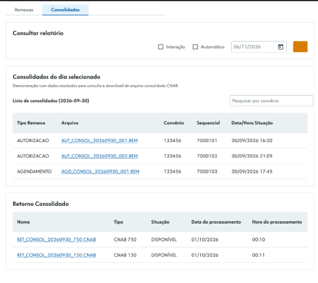

# Escopo atual — STRY00144093

Decisões fornecidas pelo desenvolvedor: frontend apenas, backend e leiautes ainda inexistentes; layout e consultas com mocks; Figma como guia visual, HU vigente como fonte de requisitos, comportamento, campos e localização. Não equivale à aprovação A1/A2/A3.

Leia user-story.md, consolidado-dependencia.md, requirements-analysis.md e approvals.md. A análise anterior deve ser revisada: contratos reais e leiautes são dependências futuras, não bloqueios para layout. CA01 terá evidência parcial/simulada nesta fase; download real e geração CNAB permanecem pendentes. CA02 e UI01/UI02 podem ser verificados com fixtures. UI03: ação simulada, sem produzir CNAB válido. AC01: investigar mecanismo existente; não inventar permissões.

## Referência visual

A imagem sugere abas Remessas/Consolidados, consulta de relatório, lista superior e card inferior Retorno Consolidado. A HU exige lista anterior ao card, colunas Tipo de Remessa, Arquivo (download), Convênio, Sequencial, Data/hora situação; card com Nome, Tipo, Situação, Data do processamento, Hora do processamento; formatos 750 e 150 e usuário Matriz. Não omitir esses requisitos. Abas, filtros Interação/Automático, pesquisa por convênio e seletor específico são sugestões visuais a investigar/validar, não requisitos novos. Não copiar texto de demonstração, nomes ou datas como dados reais. A data do filtro na imagem diverge da data da lista. Não presumir rota/localização pela imagem; investigar Relatório de Remessas e confirmar com desenvolvedor/PO.

## Implementação futura após gates

Investigar componentes SIDSC, tabelas, filtros, permissões e download existentes. Propor modelos internos mínimos, fonte mockada encapsulada, dados sintéticos determinísticos e consultas por data conforme decisão aprovada. Store quando justificada pelo estado; não criar camadas vazias. Nenhuma chamada HTTP nova, endpoint inventado, geração CNAB ou mudança de infraestrutura. Simular download apenas conforme plano aprovado, com indicação inequívoca de simulação. Não expor mocks como dados reais em produção; definir estratégia de isolamento antes de implementar. Testar campos, ordem, formatos, consulta e estados aprovados; 80% por arquivo. Preservar Remessas e demais funcionalidades.
